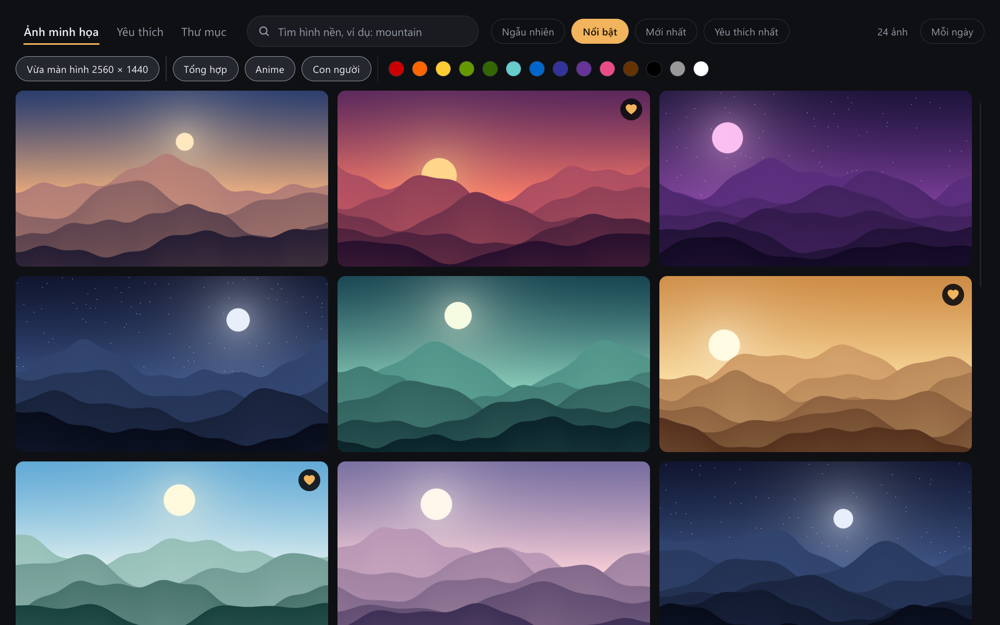
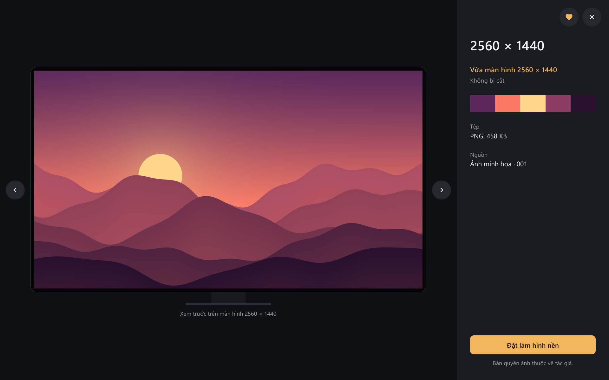
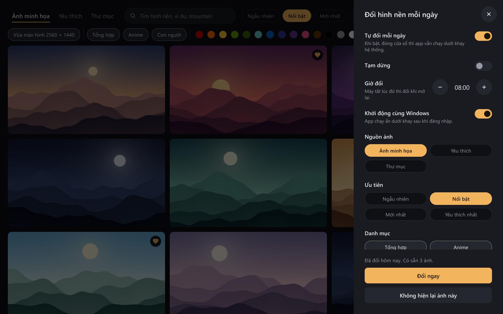

# Wallpaper Desktop App

App đổi hình nền cho Windows 10 và 11: nhẹ, mở nhanh, tự tìm ảnh vừa màn hình. Viết bằng Rust và [Slint](https://slint.dev), miễn phí và mã nguồn mở.

> Đang phát triển, chưa có bản phát hành. Mới thử trên Windows 11, chưa thử Windows 10.



| Xem trước trên màn hình của bạn | Đổi hình nền mỗi ngày |
|---|---|
|  |  |

Giao diện thật; các hình nền trong ảnh do chương trình tự vẽ để minh họa.

## Đã có

- Duyệt ảnh từ [Wallhaven](https://wallhaven.cc): tìm kiếm, sắp xếp, lọc theo danh mục và màu. Chỉ lấy ảnh SFW, không cần tài khoản
- Tự đọc độ phân giải màn hình chính để lọc ảnh vừa màn hình
- Xem trước đúng phần ảnh sẽ hiện, kèm đánh giá có bị cắt hay phải phóng to không
- Đặt hình nền cho tất cả hoặc từng màn hình, cắt đúng pixel
- Hoàn tác tối đa 10 bước cho mỗi virtual desktop, về được hình nền trước khi dùng app. Riêng Spotlight và trình chiếu của Windows thì không bật lại được
- Đổi ảnh ngẫu nhiên mỗi ngày: không lặp, tải sẵn để đổi được khi mất mạng, hoãn khi đang chơi game hoặc trình chiếu
- Chạy dưới khay hệ thống, tùy chọn khởi động cùng Windows
- Yêu thích: giữ lại ảnh từ mọi nguồn, xem được cả khi mất mạng
- Ảnh từ thư mục trên máy: duyệt, tìm theo tên, đặt làm hình nền
- Đổi hằng ngày lấy ảnh từ Wallhaven, từ yêu thích hoặc từ thư mục

## Chưa có

- Nguồn ảnh trên mạng thứ hai
- Bộ cài đặt và tự cập nhật

## Chạy thử

Cần Windows, [Rust](https://rustup.rs) và Visual Studio Build Tools với workload "Desktop development with C++".

```powershell
cd project
cargo run --release -p wallpaper-desktop
```

## Cấu trúc

| Folder | Nội dung |
|---|---|
| [`project/`](project/README.md) | Source code (Cargo workspace), cách build, test và thêm nguồn ảnh |
| [`docs/`](docs/README.md) | Tài liệu phục vụ phát triển |
| [`research/`](research/README.md) | Nghiên cứu ban đầu, so sánh công nghệ và số liệu đo |

## Giấy phép

Mã nguồn theo [GPL-3.0](LICENSE). Hình nền thuộc về tác giả của chúng; app tải ảnh thẳng từ nguồn và luôn có nút mở trang gốc.
